# Architecture

## The big picture

One AWS region hosts everything. Inside it, a VPC is split into public and
private subnets across three availability zones. The EKS control plane is
managed by AWS; worker nodes run in the private subnets where nothing from the
internet can reach them directly.

```mermaid
flowchart TB
    internet(["Internet"]) --> igw["Internet Gateway"]

    subgraph vpc["VPC 10.0.0.0/16"]
        subgraph public["Public subnets (one per AZ)"]
            igw --> alb["Load Balancers"]
            nat1["NAT Gateway"]
        end

        subgraph private["Private subnets (one per AZ)"]
            nodes["EKS worker nodes<br/>(managed node groups)"]
            endpoints["VPC endpoints<br/>(ECR, S3, CloudWatch)"]
        end

        nodes -->|pull images| endpoints
        nodes -->|outbound via| nat1
        alb -->|traffic in| nodes
    end

    subgraph control["AWS-managed"]
        eks["EKS control plane<br/>(API, scheduler, logging)"]
        oidc["OIDC provider"]
    end

    eks -.->|manages| nodes
    oidc -.->|trusts| irsa["IRSA roles<br/>(EBS CSI, autoscaler)"]
    irsa -.->|used by| nodes

    logs["CloudWatch Logs<br/>(control-plane logs)"]
    eks --> logs

    state["S3 + DynamoDB<br/>(Terraform state + locking)"]
```

## What each piece does, in plain English

**VPC and subnets.** Think of the VPC as a private office building and subnets
as floors. Public floors (subnets) hold the front doors — load balancers and
NAT gateways. Private floors hold the workers (EKS nodes). Nobody from the
street can walk onto a private floor.

**NAT gateways.** Workers on private floors sometimes need to fetch things from
outside (a software update, an external API). The NAT gateway is the building's
single supervised exit: traffic can go out, but nobody can come in through it.

**VPC endpoints.** For AWS services (container images in ECR, logs in
CloudWatch), workers don't even use the exit — endpoints are private tunnels
straight to those services. Cheaper than NAT traffic and they keep working even
if the NAT gateway has a bad day.

**EKS control plane.** AWS runs the Kubernetes "brain" (the API server,
scheduler, controllers). We don't patch or babysit it; we pick the version and
AWS keeps it healthy. Its logs stream to CloudWatch so we can debug the
"What just happened?" moments.

**Managed node groups.** The workers. We declare "I want 2–6 machines of this
size, some on-demand and some spot", and AWS keeps that many healthy machines
running, replacing any that fail.

**IRSA.** Normally, giving an app AWS permissions means handing credentials to
a whole machine. IRSA instead gives a single Kubernetes service account its own
IAM role — the EBS storage driver can manage disks, but nothing else on the
machine can.

**Add-ons.** Networking (VPC CNI), DNS (CoreDNS), and storage (EBS CSI) are
managed as versioned EKS add-ons, so upgrades go through the same pull-request
review as everything else.

**State backend.** Terraform remembers what it built in a state file. That file
lives in S3 (versioned, encrypted), and a DynamoDB table acts as a lock so two
people never rewrite it at the same time.

## Environments

| Environment | Purpose | Cost posture |
|---|---|---|
| `dev` | Experiment freely | Single NAT, small spot-heavy nodes |
| `staging` | Realistic release testing | HA networking, mid-size nodes |
| `prod` | Real traffic | Multi-AZ NAT, private API endpoint, on-demand baseline |

Each environment is the same modules with different inputs — see `envs/`.
